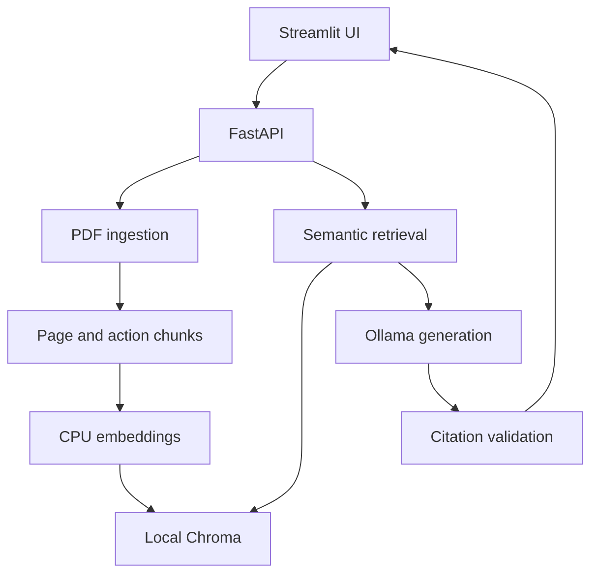

# Evidence Desk — local document Q&A with inspectable citations

A single-user RAG application for answering questions about AI governance documents. It retrieves source passages, generates a local answer, and checks that every cited quotation actually occurs in the supplied evidence. The UI exposes the passage and exact PDF page for inspection.

**Status:** working local prototype; public deployment is not performed. This is a portfolio project, not a production compliance product. The checked-in evaluation distinguishes retrieval relevance, claim grounding, missing answers, and latency. Independent human review is still required.

## Why this problem and corpus?

Risk and product teams need to trace a proposed interpretation back to source guidance. This is the same evidence-auditing habit used when checking AI-generated prescriptions against consultation transcripts: a fluent response can still be wrong.

The reproducible benchmark uses **NIST AI RMF 1.0, NIST AI 100-1 (January 2023), 48 PDF pages**. The PDF is retrieved from the U.S. Government Publishing Office archive and checked against `corpus/manifest.json`. NIST's direct endpoints returned HTTP 403 in the build environment. The originally proposed Generative AI Profile extension was not indexed because its PDF bytes could not be retrieved reliably. No draft was silently substituted. This is a historical, single-document benchmark with cross-section questions, not a current-law assistant or a demonstrated multi-document benchmark.

The report contains prose and two-column governance tables. Visual inspection showed that generic extraction interleaved category descriptions with numbered actions. A **hash-scoped parser rule** isolates the action/subcategory column for this exact PDF. Other uploads use ordinary text extraction. Category-column descriptions and diagram interpretation are outside this benchmark's extraction coverage.

## Architecture



| Module | Responsibility |
|---|---|
| `ingestion/` | PDF validation, page text preservation, bounded token chunks, stable IDs |
| `retrieval/` | E5 prefixes, token-limit enforcement, persistent cosine search and filters |
| `generation/` | Local Ollama and explicit optional API adapters |
| `citations.py` | Reject unknown source IDs, missing citations and fabricated quotations |
| `api/` | Upload, query, health and PDF-serving endpoints |
| `ui/` | Upload and chat interface, references and PDF page links |
| `evaluation/` | Frozen questions, metrics, experiment runners and reviewed reports |

The API owns the database and serializes expensive operations. The UI only calls HTTP endpoints. Chat messages remain visible, but each question is independent: follow-ups must repeat the relevant subject. This avoids treating chat history as evidence.

## Hardware profile and cost

The target machine has an i5-1240P, 15.7 GB usable RAM, Iris Xe integrated graphics and approximately 101 GB available disk space. No supplied device or product identifiers are retained.

- CPU-only inference is the supported baseline. Iris Xe acceleration is not assumed.
- Default portfolio evaluation profile: `qwen2.5:3b-instruct-q4_K_M`, four CPU threads, one query at a time, 4096 context tokens, 384 output tokens. Its weights use the Qwen research license (non-commercial research/evaluation); project MIT licensing applies only to our code.
- Optional quality comparison: `qwen2.5:7b-instruct-q4_K_M`. Download only when needed; it has **not** been benchmarked here.
- Experimental speed profile: `qwen2.5:1.5b-instruct-q4_K_M`, 256 output tokens. It was evaluated separately and can fail structured-output checks. Its results must not be presented as the default 3B model's results.
- Ollama lists approximately 1.9 GB for 3B and 4.7 GB for 7B; those are download sizes, not RAM requirements. Plan roughly 15–20 GB of free space for native setup and caches; this is an allowance, not a measured installation size. Docker can require substantially more.
- No paid API, subscription or GPU is needed locally. First setup requires internet downloads; cached models and local PDFs can then run offline.

**Latency is not guaranteed.** Initial 3B sizing questions took about 71 and 127 seconds on the build machine with the earlier, more verbose prompt. These are not i5 laptop measurements. The final prompt asks for short supporting quotes. Run the evaluator on your laptop before quoting its performance in an interview.

## Native Windows setup (recommended for this laptop)

Prerequisites: Python **3.12 x64**, Git if using a repository clone, and [Ollama for Windows](https://docs.ollama.com/windows). Ollama requires Windows 10 22H2 or newer; check `winver` because the supplied specifications do not establish the OS version. Keep Ollama running in the tray.

Open PowerShell **in this project directory**:

```powershell
py -3.12 -m venv .venv
.\.venv\Scripts\python.exe -m pip install torch==2.8.0 --index-url https://download.pytorch.org/whl/cpu
.\.venv\Scripts\python.exe -m pip install -e .
Copy-Item .env.example .env
ollama pull qwen2.5:3b-instruct-q4_K_M
.\.venv\Scripts\python.exe -m grounded_qa.cli doctor
.\.venv\Scripts\python.exe -m grounded_qa.cli fetch
.\.venv\Scripts\python.exe -m grounded_qa.cli ingest
.\.venv\Scripts\python.exe -m pytest -q
```

No virtual-environment activation or PowerShell policy change is required. Do not overwrite an existing `.env` when upgrading. `scripts/setup-windows.ps1` offers the dependency steps if local script execution is permitted.

Start the API in one terminal:

```powershell
.\.venv\Scripts\python.exe -m uvicorn grounded_qa.api.main:app --host 127.0.0.1 --port 8000
```

Start the UI in a second terminal:

```powershell
.\.venv\Scripts\python.exe -m streamlit run ui/app.py --server.address 127.0.0.1 --browser.gatherUsageStats false
```

Visit [the UI](http://localhost:8501) and [API documentation](http://localhost:8000/docs). Try “What does GOVERN 1.6 say about inventorying AI systems?” First model loading can be slow. Uploaded PDFs must have a text layer; empty, encrypted, malformed or oversized PDFs return clear errors.

On Linux, use `python3.12 -m venv .venv`, `.venv/bin/python`, and `cp .env.example .env`; the remaining commands are equivalent. Start Ollama with `ollama serve` if it is not already running.

Direct dependencies are pinned in `requirements.txt`. `requirements-linux.lock.txt` records the complete tested Linux environment; do not blindly use its Linux-specific wheels on Windows. Native Windows and Docker builds have not been executed in this Linux workspace. The installed Linux dependency set passes `pip check`.

## Configuration and API

`.env.example` documents paths, models, token budgets, upload limits and timeouts. Changing the embedding model/revision, chunk size or parser version creates a new index namespace: re-ingest the corpus. Deleting `data/chroma` removes indexes, not original downloaded sources; never delete data without a backup if it contains your own uploads.

```http
POST /query
Content-Type: application/json

{"question":"What does GOVERN 1.6 describe?","document_ids":[]}
```

The response includes `claims`, their `evidence`, source text/page/chunk metadata, `abstain`, a reason and timings. `POST /documents` accepts multipart PDF upload; `GET /documents` lists stored documents; `GET /documents/{sha256}/pdf#page=N` opens the source page.

Optional paid providers are **explicit opt-ins**, never automatic fallbacks. Set `LLM_PROVIDER=openai` or `anthropic`, `PROVIDER_URL`, `LLM_MODEL` and `API_KEY` locally. OpenAI uses a Chat Completions-compatible endpoint; Anthropic uses `/v1/messages`. These adapters have not been live-tested and provider/model-specific parameter compatibility must be checked. Your evidence leaves the machine only when you explicitly select such a provider. No key is checked in.

## Citation contract

1. Retrieved chunks get temporary `S1`, `S2`, etc. IDs.
2. The generator emits structured claims and exact supporting quotations.
3. The backend resolves titles and pages from ingestion metadata, checks quote membership and rejects IDs outside the provided evidence.
4. Invalid output is retried once; persistent invalid output becomes an abstention.
5. The UI shows the evidence and links to the **1-based PDF page**, not an assumed printed page label. Detected section headings are labeled heuristic.

A matching quotation **does not prove entailment**. It can be irrelevant, incomplete, or misinterpreted. The evaluator separately reviews claim support. Documents are treated as untrusted text rather than instructions; prompt injection is reduced, not solved.

## Evaluation

The set contains 24 source-checked questions: 8 facts, 6 action lookups, 4 synthesis questions, 4 unanswerables and 2 misleading-premise questions. Gold evidence contains document hashes, exact page offsets and excerpts. There are 8 development and 16 test assignments. Because prompt sizing and exploratory inspection occurred during this build, this is **an exploratory benchmark, not a sealed held-out estimate**. Preserve a new untouched test set for future tuning claims.

- **Precision@5:** assistant-judged relevant retrieved chunks divided by five, counting missing slots as non-relevant. Same-page coincidence does not count.
- **Faithfulness:** supported emitted statements divided by emitted factual statements. Every part of a compound statement must be supported; partial support is labeled unsupported. No-claim abstentions are N/A.
- **Completeness:** required expected facts correctly conveyed / required facts. Abstentions on answerable questions score zero.
- **Abstention:** correct refusals and false refusals reported separately.
- **Latency:** real request-to-final-response time, including retries. One pass includes cold effects; no claim of stable warm p95.

These are custom RAGAS-style metrics, **not official RAGAS scores**. Labels are assistant-reviewed; independent human annotation and inter-rater agreement remain pending. The builder and reviewer are not independent. The baseline can be highly faithful on a small number of answered questions while still being unhelpful; read completeness and false abstentions with faithfulness.

See [the full results table](evaluation/results/RESULTS.md), [raw runs](evaluation/runs/), [review labels](evaluation/review.json), [embedding ablation](evaluation/ablation.json) and [chunk ablation](evaluation/chunk-ablation.json).

<!-- EVALUATION_SUMMARY -->


To reproduce a default-model run:

```powershell
.\.venv\Scripts\python.exe -m grounded_qa.evaluation.run --out evaluation/runs/my-laptop-3b.json
```

To reproduce the evaluated speed profile, set `$env:LLM_MODEL="qwen2.5:1.5b-instruct-q4_K_M"` and `$env:OUTPUT_TOKENS="256"`, pull that model with Ollama, and run the same command with a different output filename. Remove those environment overrides to return to `.env` defaults.

The report command accepts `--run` and `--labels`. New outputs require fresh semantic review; do not reuse checked-in labels blindly. To rerun retrieval-only experiments use `python -m grounded_qa.evaluation.ablate` and `python -m grounded_qa.evaluation.chunk_ablation`. They read development queries only. A stronger future study should include at least three warm timing repetitions and independent human review.

## Interview tradeoffs

| Choice | Defensible explanation |
|---|---|
| Local Ollama | Removes required API spend and keeps evidence local, at the cost of CPU latency and weaker small-model instruction following. |
| E5-small-v2 | CPU-friendly retrieval model with a 512-token input limit; explicit query/passage prefixes. It is not proven best: MiniLM won this tiny development span-recall comparison. E5 is retained as the frozen longer-chunk baseline, not as a claimed optimal model. |
| Recursive/action chunks | Preserve action IDs and avoid mixing adjacent recommendations. Fixed windows tied on development span recall; the reason to keep this strategy is citation readability, not a claimed measured recall gain. |
| Chroma over FAISS | Built-in text/metadata storage, filtering and upserts reduce application bookkeeping for uploads. FAISS flat search remains a strong simpler search-engine baseline, but needs a companion metadata store. |
| Explicit pipeline over an agent | Predictable retrieval, bounded costs, testable failures. LangChain supplies the splitter; it does not hide orchestration or citations. |
| Strict citation schema | Rejects broken attribution, but raises false abstentions with small models. The failure is visible rather than silently repaired into a confident answer. |

## Docker and prepared hosting

Docker is optional on your laptop. With Docker installed and `.env` copied:

```sh
docker compose build
docker compose up -d ollama
docker compose exec ollama ollama pull qwen2.5:3b-instruct-q4_K_M
docker compose run --rm api python -m grounded_qa.cli fetch
docker compose run --rm api python -m grounded_qa.cli ingest
docker compose up -d api ui
```

Named volumes preserve models and documents. The published local ports bind to loopback. Stop with `docker compose down`; adding `-v` would delete named volumes. The UI can download source PDFs even when the backend has a Docker-internal hostname.

`deploy/spaces/` contains a prepared Docker Space configuration and a supervised API/UI launcher. **Nothing has been pushed or deployed.** Current [Hugging Face documentation](https://huggingface.co/docs/hub/spaces-overview) requires a paid plan to create Docker compute Spaces; a zero-hourly-cost CPU tier does not make creation universally free. Recheck the policy and account eligibility before deployment. The hosted profile is read-only **extractive evidence browsing**, not 7B generation. It uses the fixed report and ephemeral storage. A free static showcase is in `deploy/static/`; it displays recorded results and cannot answer new questions.

## Validation and limitations

- 22 unit/API tests pass; actual E5 → Chroma → FastAPI → citation validation → PDF serving also passed an integration smoke test.
- Linux dependencies installed successfully and `pip check` passed. Native Windows, Docker runtime, browser layout and public hosting are not certified by these tests.
- One small historical report; generic uploads do not inherit its specialized table parser. No OCR, reliable diagram understanding, exhaustive table extraction or multi-document benchmark.
- Page-bound chunking can lose context across pages. Similarity is not calibrated confidence. Character-based generation context budgeting is a heuristic; unusual text can tokenize differently.
- Smaller models can produce unsupported statements, invalid JSON, contradictory abstention flags or incorrect interpretations despite valid source IDs.
- No authentication, production monitoring, durable hosted storage, multi-user isolation, upload malware scanning, reranker or hybrid keyword search. Bind locally; prepared public demo disables uploads.
- Current benchmark has a small sample, assistant-authored questions and judgments, no independent evaluator and only one timing pass. Do not market the numbers as production reliability.

## Sources and provenance

See [DESIGN.md](DESIGN.md) and [RESEARCH.md](RESEARCH.md) for alternatives, implementation deviations and primary references. Corpus download bytes and model weights are not in Git. Project code uses MIT; source documents, dependencies and models retain their own terms.

The deliverable includes `history.bundle` containing incremental Git commits. To restore the repository with history, run `git clone history.bundle evidence-desk`, then work inside `evidence-desk`. Commits use a neutral `Project Builder` identity; configure your own Git name/email for future commits. No GitHub remote is configured or published.
