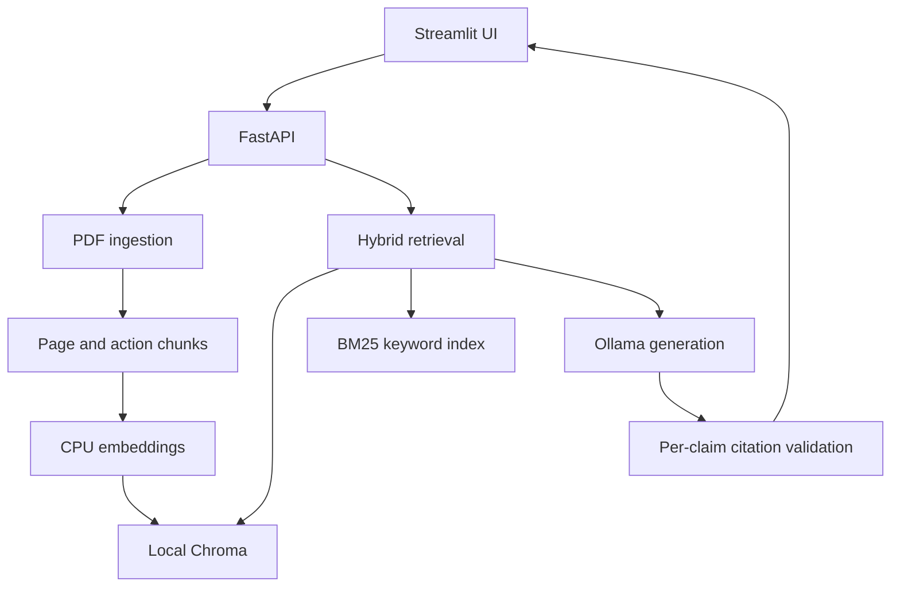
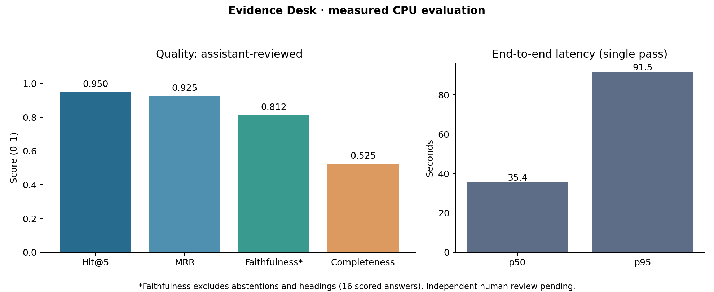

# Evidence Desk — local document Q&A with inspectable citations

[](https://github.com/karmanyamehta-prog/evidence-desk/actions/workflows/tests.yml)

A single-user RAG application for answering questions about AI governance documents. It retrieves source passages, generates a local answer, and checks that every cited quotation actually occurs in the supplied evidence. The UI exposes the passage and exact PDF page for inspection.

**Status:** working local prototype; public deployment is not performed. This is a portfolio project, not a production compliance product. The checked-in evaluation distinguishes retrieval relevance, claim grounding, missing answers, and latency. Independent human review is still required.

## Why this problem and corpus?

Teams that use AI guidance need to trace a proposed interpretation back to its source text. A fluent answer can still be wrong, so the app shows the exact passage and PDF page behind every claim and refuses to show an answer whose quotes cannot be found in the retrieved text.

The reproducible corpus is **two NIST documents**, each verified against its own SHA-256 in `corpus/manifest.json`:

| Document | Publication | Pages | Source |
|---|---|---:|---|
| NIST AI RMF 1.0 | NIST AI 100-1 (2023-01) | 48 | U.S. Government Publishing Office archive |
| AI RMF: Generative AI Profile | NIST AI 600-1 (2024-07) | 64 | `nvlpubs.nist.gov` |

Both are fetched and ingested by one command (`python -m grounded_qa.cli fetch` / `ingest`) into a single vector store (320 chunks). The Generative AI Profile was previously listed as "not indexed because its PDF bytes could not be retrieved reliably"; that is now resolved — the PDF is retrieved and checksum-verified.

The RMF report contains prose and two-column governance tables. Visual inspection showed that generic extraction interleaved category descriptions with numbered actions. A **hash-scoped parser rule** isolates the action/subcategory column for that exact PDF. Other documents, including the Generative AI Profile, use ordinary text extraction. Category-column descriptions and diagram interpretation are outside this benchmark's extraction coverage.

Two action-ID schemes are recognised: the RMF's `GOVERN 1.6` and the Generative AI Profile's `A.1.1`. Both are prepended to the **embedding text only** — the stored chunk text stays the verbatim source passage, so quotes and page offsets are unaffected.

## Architecture



## Retrieval

Cosine similarity over E5-small-v2 vectors, fused with a BM25 keyword index by
**reciprocal rank fusion** (k=60). The two rankings fail differently — cosine
misses an exact action ID whose wording differs from the question, BM25 misses
paraphrase — so fusing them is more robust than either alone. The BM25 index
is rebuilt in memory from the stored chunk texts at query time, so there is no
second persistence layer to keep in sync. If `rank-bm25` is not installed, the
service logs a warning and uses cosine only.

`MIN_RETRIEVAL_DISTANCE` drops hits whose cosine distance is at or beyond a
cutoff. The default is `0.0`, which disables the filter: a cutoff is only
worth setting once it has been measured on a labelled set, and the earlier
observation that a cutoff near 0.16 separates answerable from unanswerable
questions rested on four unanswerable questions. A keyword-only hit gets its
**true** cosine distance computed from the stored vectors, so the threshold
means the same thing for every hit.

| Module | Responsibility |
|---|---|
| `ingestion/` | PDF validation, page text preservation, bounded token chunks, stable IDs |
| `retrieval/` | E5 prefixes, token-limit enforcement, persistent cosine search, BM25 keyword index and RRF fusion |
| `generation/` | Local Ollama and explicit optional API adapters |
| `citations.py` | Reject unknown source IDs, missing citations and fabricated quotations; drop only the failing claim |
| `api/` | Upload, query, health and PDF-serving endpoints |
| `ui/` | Upload and chat interface, references and PDF page links |
| `evaluation/` | Frozen questions, metrics, experiment runners and reviewed reports |

The API owns the database and serializes expensive operations. The UI only calls HTTP endpoints. Chat messages remain visible, but each question is independent: follow-ups must repeat the relevant subject. This avoids treating chat history as evidence.

## Hardware profile and cost

The target machine has an i5-1240P, 15.7 GB usable RAM, Iris Xe integrated graphics and approximately 101 GB available disk space. No supplied device or product identifiers are retained.

- CPU-only inference is the supported baseline. Iris Xe acceleration is not assumed.
- Default portfolio evaluation profile: `qwen2.5:3b-instruct-q4_K_M`, four CPU threads, one query at a time, 4096 context tokens, 384 output tokens. Its weights use the Qwen research license (non-commercial research/evaluation); project MIT licensing applies only to our code.
- Optional quality comparison: `qwen2.5:7b-instruct-q4_K_M`. Download only when needed; it has **not** been benchmarked here.
- Experimental speed profile: `qwen2.5:1.5b-instruct-q4_K_M`, 256 output tokens. It was evaluated separately and can fail structured-output checks. Its results must not be presented as the default 3B model's results.
- Ollama lists approximately 1.9 GB for 3B and 4.7 GB for 7B; those are download sizes, not RAM requirements. Plan roughly 15–20 GB of free space for native setup and caches; this is an allowance, not a measured installation size. Docker can require substantially more.
- No paid API, subscription or GPU is needed locally. First setup requires internet downloads; cached models and local PDFs can then run offline.

**Latency is not guaranteed.** Initial 3B sizing questions took about 71 and 127 seconds on the build machine with the earlier, more verbose prompt. These are not i5 laptop measurements. The final prompt asks for short supporting quotes. Run the evaluator on your laptop before quoting its performance in an interview.

## Native Windows setup (recommended for this laptop)

Prerequisites: Python **3.12 x64**, Git if using a repository clone, and [Ollama for Windows](https://docs.ollama.com/windows). Ollama requires Windows 10 22H2 or newer; check `winver` because the supplied specifications do not establish the OS version. Keep Ollama running in the tray.

Open PowerShell **in this project directory**:

```powershell
py -3.12 -m venv .venv
.\.venv\Scripts\python.exe -m pip install torch==2.8.0 --index-url https://download.pytorch.org/whl/cpu
.\.venv\Scripts\python.exe -m pip install -e . -r requirements-dev.txt
Copy-Item .env.example .env
ollama pull qwen2.5:3b-instruct-q4_K_M
.\.venv\Scripts\python.exe -m grounded_qa.cli doctor
.\.venv\Scripts\python.exe -m grounded_qa.cli fetch
.\.venv\Scripts\python.exe -m grounded_qa.cli ingest
.\.venv\Scripts\python.exe -m pytest -q
```

No virtual-environment activation or PowerShell policy change is required. Do not overwrite an existing `.env` when upgrading. `scripts/setup-windows.ps1` offers the dependency steps if local script execution is permitted.

Start the API in one terminal:

```powershell
.\.venv\Scripts\python.exe -m uvicorn grounded_qa.api.main:app --host 127.0.0.1 --port 8000
```

Start the UI in a second terminal:

```powershell
.\.venv\Scripts\python.exe -m streamlit run ui/app.py --server.address 127.0.0.1 --browser.gatherUsageStats false
```

Visit [the UI](http://localhost:8501) and [API documentation](http://localhost:8000/docs). Try “What does GOVERN 1.6 say about inventorying AI systems?” First model loading can be slow. Uploaded PDFs must have a text layer; empty, encrypted, malformed or oversized PDFs return clear errors.

`fetch` downloads every document in `corpus/manifest.json` and verifies each against its recorded SHA-256; `ingest` indexes them all. Both are idempotent: an already-verified file is not re-downloaded, and an already-indexed document is not re-chunked.

On Linux, use `python3.12 -m venv .venv`, `.venv/bin/python`, and `cp .env.example .env`; the remaining commands are equivalent. Start Ollama with `ollama serve` if it is not already running.

Runtime dependencies are pinned in `requirements.txt`; tests, lint and the report generator need `requirements-dev.txt`. `requirements-linux.lock.txt` records the complete tested Linux environment; do not blindly use its Linux-specific wheels on Windows. Native Windows and Docker builds have not been executed in this Linux workspace. The installed Linux dependency set passes `pip check`.

## Configuration and API

`.env.example` documents paths, models, token budgets, upload limits and timeouts. Changing the embedding model/revision, chunk size or parser version creates a new index namespace: re-ingest the corpus. Deleting `data/chroma` removes indexes, not original downloaded sources; never delete data without a backup if it contains your own uploads.

```http
POST /query
Content-Type: application/json

{"question":"What does GOVERN 1.6 describe?","document_ids":[]}
```

The response includes `claims`, their `evidence`, source text/page/chunk metadata, `abstain`, a reason and timings. `POST /documents` accepts multipart PDF upload; `GET /documents` lists stored documents; `GET /documents/{sha256}/pdf#page=N` opens the source page.

Optional paid providers are **explicit opt-ins**, never automatic fallbacks. Set `LLM_PROVIDER=openai` or `anthropic`, `PROVIDER_URL`, `LLM_MODEL` and `API_KEY` locally. OpenAI uses a Chat Completions-compatible endpoint; Anthropic uses `/v1/messages`. These adapters have not been live-tested and provider/model-specific parameter compatibility must be checked. Your evidence leaves the machine only when you explicitly select such a provider. No key is checked in.

## Citation contract

1. Retrieved chunks get temporary `S1`, `S2`, etc. IDs. They are packed into the context budget **closest-match first**, so the best match is never crowded out by a weaker one.
2. The generator emits structured claims and exact supporting quotations.
3. The backend resolves titles and pages from ingestion metadata and rejects IDs outside the provided evidence. A quote must be 5-70 words and occur in the cited chunk after folding curly quotes, dashes, Unicode forms and line-break hyphens. Any section identifier named in a claim (for example `MANAGE 2.5` or `A.1.1`) must also appear in its quote.
4. **Validation is per claim, not per answer.** A claim that fails provenance is dropped and the rest of the answer is kept; the dropped claim is recorded in the `attempts` log. One bad citation no longer discards a good answer.
5. If *every* claim fails, the output is retried once (the retry prompt includes the validation error). If it still fails, the answer is **rejected**: no answer is shown.
6. The response carries `status`: `answered` (at least one valid claim), `abstained` (the model itself returned no claims), `rejected` (no valid claim survived validation), or `error`. An `attempts` log holds the raw model output and the validation error for each try.
7. The UI shows the evidence and links to the **1-based PDF page**, not an assumed printed page label. Detected section headings are labeled heuristic.

A matching quotation **does not prove entailment**. It can be irrelevant, incomplete, or misinterpreted. The evaluator separately reviews claim support. Documents are treated as untrusted text rather than instructions; prompt injection is reduced, not solved.

## Evaluation

The set contains 24 source-checked questions: 8 facts, 6 action lookups, 4 synthesis questions, 4 unanswerables and 2 misleading-premise questions. Gold evidence contains document hashes, exact page offsets and excerpts. There are 8 development and 16 test assignments. Because prompt sizing and exploratory inspection occurred during this build, this is **an exploratory benchmark, not a sealed held-out estimate**. Preserve a new untouched test set for future tuning claims.

A second set, `evaluation/queries-crossdoc.json`, adds 11 questions over the two-document corpus: 5 single-document, 3 cross-document and 3 unanswerable. Its gold spans are **derived from the extracted text** by `tools/build_crossdoc_queries.py` rather than typed by hand, so a parser change that moves the text is caught instead of silently invalidating the labels. Run `python tools/build_crossdoc_queries.py --check` to re-verify every span.

- **Precision@5:** assistant-judged relevant retrieved chunks divided by five, counting missing slots as non-relevant. Same-page coincidence does not count.
- **Faithfulness:** supported emitted statements divided by emitted factual statements. Every part of a compound statement must be supported; partial support is labeled unsupported. Abstentions and outputs containing only headings are N/A; non-factual fragments do not inflate this score.
- **Completeness:** required expected facts correctly conveyed / required facts. Abstentions on answerable questions score zero. Count facts in the answer text; supporting quotations alone do not rescue a missing answer.
- **Abstention:** correct and false structured abstentions (`abstain=true`) reported separately. A sentence such as “not specified” with `abstain=false` is not counted; the raw answer and review explain this distinction.
- **Latency:** real request-to-final-response time, including retries. One pass includes cold effects; no claim of stable warm p95.

These are custom RAGAS-style metrics, **not official RAGAS scores**. Labels are assistant-reviewed; independent human annotation and inter-rater agreement remain pending. The builder and reviewer are not independent. The baseline can be highly faithful on a small number of answered questions while still being unhelpful; read completeness and false abstentions with faithfulness.

See [the full results table](evaluation/results/RESULTS.md), [raw runs](evaluation/runs/), [review labels](evaluation/review.json), [embedding ablation](evaluation/ablation.json) and [chunk ablation](evaluation/chunk-ablation.json).

Measured profile: **Qwen2.5 1.5B Q4_K_M**, 24 queries, one CPU pass, **recorded before the validator was tightened** (see `CHANGES.md`). Replaying the recorded answers through the new validator rejects the three answers with a wrong section ID (q13, q14, q16) and leaves the other recorded answers unchanged; a fresh run is still needed. These are not results for the default 3B model or the target laptop.

### The 3B model abstains when the answer is buried in a chunk

Measured on the target laptop with `qwen2.5:3b-instruct-q4_K_M` running for real. This is the dominant failure mode and it is **not** a retrieval failure.

For q01 ("Is AI RMF 1.0 voluntary or mandatory?") the gold text is retrieved and is present in the prompt — but it sits 1296 characters into a 1628-character chunk. The same model, given that same chunk with the answer at the start, answers correctly; given the chunk unchanged, it abstains. Retrieval Hit@5 for this question is 1.0. The evidence was there and the model would not use it.

This is a "lost in the middle" failure at 3B scale: a small model attends poorly to text buried inside a long context window, and reads that as "the evidence does not answer this", which it then reports as `{"claims": []}`. It is why the abstention rate is high, and it is not what the 1.5B run measured. `tools/probe_chunk_size.py` measures the answer rate against chunk size on the same questions; the results are recorded in `CHANGES.md`.

The practical consequence for a portfolio claim: **on this corpus, the retrieval layer and the generation layer have separate failure modes, and improving one does not improve the other.** Retrieval Hit@5 was already 0.95 on the 1.5B run, so retrieval was not the bottleneck.

| Metric | Measured value | Denominator / interpretation |
|---|---:|---|
| Hit@1 (= Precision@1) | 0.900 | 20 answerable queries |
| Hit@5 | 0.950 | 19 of 20 answerable queries had a judged-relevant chunk in the top 5 |
| MRR | 0.925 | Judged-relevant chunks only |
| Precision@5 | 0.310 | Capped by design: 13 of 20 questions have one judged-relevant chunk, so their maximum is 0.2. Do not read it as "retrieval pads results with noise". |
| Gold-span recall@5 | 0.850 | Mean coverage of selected evidence spans |
| Faithfulness, macro | 0.8125 | 16 answers containing factual statements |
| Faithfulness, micro | 15/19 | Supported factual statements |
| Answer completeness | 0.525 | 20 answerable queries, including abstentions |
| Correct structured abstentions | 2/4 | Both were validation rejections. **The model itself never returned an empty answer in this run (0 model-initiated abstentions).** |
| False abstentions | 4/20 | Answerable queries |
| Request latency p50 / p95 | 35.4s / 91.5s | All 24 queries; includes retries and cold effects |

The first retrieved result was relevant for 18 of 20 answerable questions, but many lower-ranked passages were irrelevant. Quote checks also did not prevent wrong action attribution (`q13`), off-topic supported answers (`q06`, `q22`), or heading-only outputs (`q11`, `q12`). Two correctly refused out-of-scope questions were blocked by validation failures, not demonstrated recognition of missing evidence. Full review rationales are retained.

**Interpretation:** useful evidence retrieval, limited small-model answer quality. This is a measured baseline to improve, not a reliable autonomous governance assistant. Evaluating the 3B profile on the target laptop and adding independently reviewed questions are the next validation steps.




To reproduce a default-model run:

```powershell
.\.venv\Scripts\python.exe -m grounded_qa.evaluation.run --out evaluation/runs/my-laptop-3b.json
```

To reproduce the evaluated speed profile, set `$env:LLM_MODEL="qwen2.5:1.5b-instruct-q4_K_M"` and `$env:OUTPUT_TOKENS="256"`, pull that model with Ollama, and run the same command with a different output filename. Remove those environment overrides to return to `.env` defaults.

The report command accepts `--run` and `--labels`. New outputs require fresh semantic review; do not reuse checked-in labels blindly. To rerun retrieval-only experiments use `python -m grounded_qa.evaluation.ablate` and `python -m grounded_qa.evaluation.chunk_ablation`. They read development queries only. A stronger future study should include at least three warm timing repetitions and independent human review.

## Interview tradeoffs

| Choice | Defensible explanation |
|---|---|
| Local Ollama | Removes required API spend and keeps evidence local, at the cost of CPU latency and weaker small-model instruction following. |
| E5-small-v2 | CPU-friendly retrieval model with a 512-token input limit; explicit query/passage prefixes. It is not proven best: MiniLM won this tiny development span-recall comparison. E5 is retained as the frozen longer-chunk baseline, not as a claimed optimal model. |
| Recursive/action chunks | Preserve action IDs and avoid mixing adjacent recommendations. Fixed windows tied on development span recall; the reason to keep this strategy is citation readability, not a claimed measured recall gain. |
| Chroma over FAISS | Built-in text/metadata storage, filtering and upserts reduce application bookkeeping for uploads. FAISS flat search remains a strong simpler search-engine baseline, but needs a companion metadata store. |
| Explicit pipeline over an agent | Predictable retrieval, bounded costs, testable failures. LangChain supplies the splitter; it does not hide orchestration or citations. |
| Strict citation schema | Rejects broken attribution, but raises false abstentions with small models. The failure is visible rather than silently repaired into a confident answer. |
| Per-claim filtering | A single bad citation discards a good answer. Validating each claim separately keeps the answer and records the failure, so the failure rate is still visible in the `attempts` log. |
| Hybrid retrieval (BM25 + RRF) | Cosine and keyword search fail on different questions. Fusing them is cheap here (320 chunks, index rebuilt per query) and makes an exact action ID findable even when the wording differs from the question. |
| Distance threshold off by default | A cutoff that separates answerable from unanswerable questions on four unanswerable questions is not a threshold. The knob exists and is measured; the default stays disabled until it is set from a labelled set. |
| Two documents, one store | Multi-document is a real requirement for this domain, and one vector store with a `document_id` filter is simpler than two. The second document also proves the parser is not hard-wired to one PDF. |

## Docker and prepared hosting

Docker is optional on your laptop. With Docker installed and `.env` copied:

```sh
docker compose build
docker compose up -d ollama
docker compose exec ollama ollama pull qwen2.5:3b-instruct-q4_K_M
docker compose run --rm api python -m grounded_qa.cli fetch
docker compose run --rm api python -m grounded_qa.cli ingest
docker compose up -d api ui
```

Named volumes preserve models and documents. The published local ports bind to loopback. Stop with `docker compose down`; adding `-v` would delete named volumes. The UI can download source PDFs even when the backend has a Docker-internal hostname.

`deploy/spaces/` contains a prepared Docker Space configuration and a supervised API/UI launcher. **Nothing has been pushed or deployed.** Current [Hugging Face documentation](https://huggingface.co/docs/hub/spaces-overview) requires a paid plan to create Docker compute Spaces; a zero-hourly-cost CPU tier does not make creation universally free. Recheck the policy and account eligibility before deployment. The hosted profile is read-only **extractive evidence browsing**, not 7B generation. It uses the fixed report and ephemeral storage. A free static showcase is in `deploy/static/`; it displays recorded results and cannot answer new questions.

## Validation and limitations

- 241 unit tests pass (Windows 11, Python 3.12), including an offline end-to-end test (real PDF parsing, chunking, Chroma and HTTP layer; the embedding model and LLM are replaced by a hashed embedder and a scripted generator). No test runs real E5 or Ollama. `ruff` and `mypy` are clean.
- The corpus, the 3B model and the retrieval layer were exercised on the target laptop for real. The **evaluation numbers below are not** from that machine's 3B model.
- Linux dependencies installed successfully and `pip check` passed. Docker runtime, browser layout and public hosting are not certified by these tests.
- Two documents are indexed, but the **published evaluation set is still single-document**: the cross-document set exists and its gold spans are verified, but no reviewed labels exist for it yet.
- The RMF report has a specialized table parser; other documents do not inherit it. No OCR, reliable diagram understanding or exhaustive table extraction.
- Page-bound chunking can lose context across pages. Similarity is not calibrated confidence. Character-based generation context budgeting is a heuristic; unusual text can tokenize differently.
- Smaller models can produce unsupported statements, invalid JSON, incorrect interpretations despite valid source IDs, and — as measured here — abstain when the answer is buried inside a retrieved chunk.
- The API rejects unexpected `Host` headers and cross-origin browser POSTs (`ALLOWED_HOSTS`), which blocks DNS rebinding and cross-site uploads to a local server. It has no authentication and must stay on loopback.
- No authentication, production monitoring, durable hosted storage, multi-user isolation, upload malware scanning or reranker. Bind locally; prepared public demo disables uploads.
- Current benchmark has a small sample, assistant-authored questions and judgments, no independent evaluator and only one timing pass. Do not market the numbers as production reliability.

## Sources and provenance

See [DESIGN.md](DESIGN.md) and [RESEARCH.md](RESEARCH.md) for alternatives, implementation deviations and primary references. Corpus download bytes and model weights are not in Git. Project code uses MIT; source documents, dependencies and models retain their own terms.
